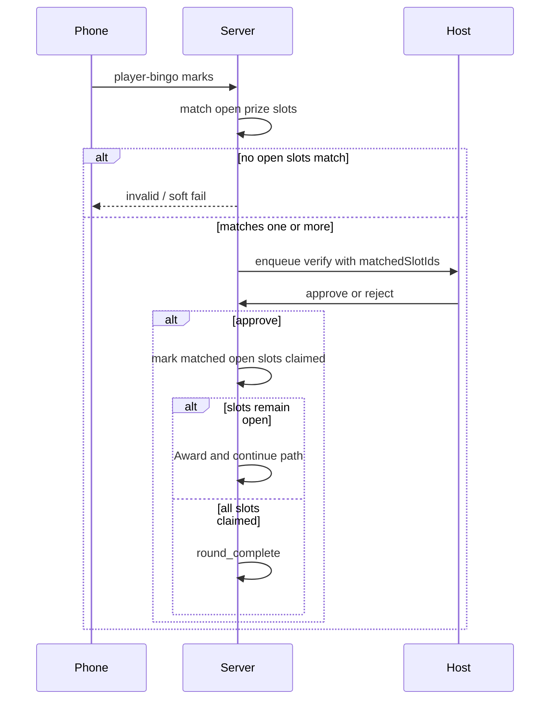

# Multi-prize pattern rounds

**Status:** implemented on branch `cursor/multi-prize-pattern-rounds` (v1)  
**Branch:** `cursor/multi-prize-pattern-rounds`

Add host-configured prize slots per round—each with its own pattern and prize label—so multiple distinct wins can be awarded in one round via the existing bingo verify queue, with a host setting for whether the same player/card can take more than one slot.

## Decisions (locked)

- Claims stay **FIFO** in the existing bingo verification queue.
- If one claim’s card satisfies **multiple open prize slots**, that player **wins all matching open slots** on approve (subject to the host multi-win setting below).
- Host setting controls same-player / same-card limits (not a fixed product rule).

## Product model

Replace “one pattern + one prize string” for a round with **prize slots** (1–N, recommend cap 3–5 for v1):

```ts
type RoundPrizeSlot = {
  id: string;           // stable within the round
  label: string;        // prize text shown to host / night board
  pattern: BingoPattern | 'line_row' | 'line_col'; // extend line orientation
  linesRequired?: number; // for line / line_row / line_col
  // optional later: custom mask / composite per slot — v1 = preset + line_row/col
  claimedBy?: { playerId, playerName, cardId, at } | null;
};
```

**Examples**

- Slot A: `line_row` → “First row”
- Slot B: `line_col` → “First column”
- Slot C: `four_corners` → “Corners prize”

Default when slots unset: behave exactly as today (single implicit slot from `room.pattern` + `currentRoundPrize`).

**Host multi-win policy** (new room/event setting, alongside existing `bingoWinPolicy`):

- `multi_slot_any` — same player/card may take multiple open slots in one round (default for this feature’s intent)
- `multi_slot_one_per_player` — after any official slot award this round, that player cannot take another slot
- `multi_slot_one_per_card` — a card that already won a slot this round is done; other cards for that player may still win

## Claim / verify flow



1. **`player-bingo`** (`server/index.js`): after Option B marks, run validation **per open slot** (not only `room.pattern`). Collect `matchedSlotIds` (+ winning positions union for host UI).
2. Apply multi-slot policy **before** enqueue: drop slots the player/card is ineligible for; if none left → reject like invalid bingo (or unofficial path unchanged for hybrid/`one_win`).
3. Queue entry stores `matchedSlotIds` (ordered by host slot order). Pause/verify UX unchanged FIFO.
4. **`verify-bingo` approve**:
   - Award **all** still-open `matchedSlotIds` on that claim (re-check open at approve time in case another claim already took a slot).
   - Append one `roundWinners` row **per awarded slot** (prize = slot.label; include `prizeSlotId`).
   - If any slots remain open → **auto Award & continue** (reuse existing `continueRound` / DQ / resume path). Do **not** end the round on first approve when slots remain.
   - If no slots remain → existing round_complete path.
5. Reject: unchanged; queue advances.

**Conflict:** Two players in queue both matched the same last open slot — first approved claim takes it; second approve finds slot closed → host sees “slot already awarded” / treat as reject-or-partial.

## Pattern work (row vs column)

Today `line` accepts any complete row/col/diag (`validateBingo.js` `checkBingoWithPlayedSongs`). Add:

- `line_row` — only horizontal lines
- `line_col` — only vertical lines

(diags stay under `line` / existing presets; not required for the “row vs column” example)

Expose in host pattern pickers used by slot editor only at first; keep standalone round pattern list compatible.

## Host / planner UI

- Round bucket / Start Game: **Prize slots** editor (add/remove/reorder; pattern + prize label per slot).
- Persist on event round prep (`EventRound`) and pass into Start Game / live room snapshot (`liveRoomSnapshot.js`).
- Host verify modal: list which slot(s) this claim will award; show remaining open slots.
- Night board / projector: show prize label per winner entry (already has `prize`); optionally show slot pattern name.

## Player UX (asymmetric-safe)

- Still **one** Hold-to-call BINGO (no spoiler of call identity).
- Pattern hint shows **all open slot patterns** as goals (“Row · Column · Corners”) without saying which songs unlock them.
- Visual enable: true if card marks satisfy **any** open slot pattern (client-side), same as today for single pattern.
- No prize picker on phone — server attaches all eligible matching slots.

## Out of scope for v1

- Per-slot custom/composite editors (presets + line_row/col only).
- Auto-ending when N distinct players have won (host can End round).
- Changing hybrid unofficial / `one_win` session policy (those keep working; multi-slot policy is additional within-round).

## Primary touch map

| Area | Files |
|------|--------|
| Slot validate | `server/game/validateBingo.js` — `line_row`/`line_col`, `matchOpenPrizeSlots(card, room)` |
| Claim / verify | `server/index.js` — `player-bingo`, `verify-bingo`, queue payload |
| Snapshot | `server/game/liveRoomSnapshot.js` |
| Host UI | `client/src/components/HostView.tsx`, round settings panels |
| Patterns | `client/src/patternDefinitions.ts` |
| Player hint | `client/src/components/PlayerView.tsx` |
| Tests | `server/game/validateBingo.test.js` + claim/verify unit coverage for multi-slot |

## Implementation todos

1. Add `RoundPrizeSlot` + multi_slot host policy; snapshot + Start Game wiring; legacy single pattern/prize = one implicit slot
2. Add `line_row`/`line_col` + `matchOpenPrizeSlots` in `validateBingo.js` with tests
3. Extend `player-bingo` queue payload + `verify-bingo` to award all matched open slots; auto-continue until slots empty
4. Prize slots editor + verify modal slot list + policy control
5. Player pattern hint lists open slot goals; BINGO enable if any open slot matches marks

## Verification

- Unit: row-only vs col-only; one claim matching two open slots; policy one-per-player blocks second slot; second queued claim loses a slot already taken.
- Manual: Plan round with 3 slots → Start Game → approve first winner → playback continues → second/third awards → round ends when last slot filled (or host ends early).
